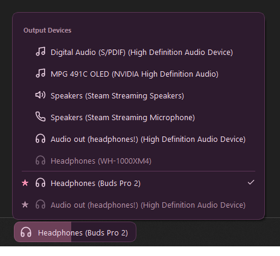

# AudioFlip

A small always-on-top Windows widget that shows your current audio device and switches it in one click, including connecting and disconnecting Bluetooth headphones.



## What it does

- **Switch output in one click** - left-click the widget, pick a device
- **Connect Bluetooth headphones without opening Settings** - paired headsets appear greyed out when disconnected; click one to connect, click it again while it is active to disconnect
- **Change volume by scrolling** over the widget, or over any of its menus
- **Pin favourites** to the top of the list (right-click a device)
- **Stays out of the way** - sits on top of the taskbar, and steps aside while a game or fullscreen video is running
- **Pair new Bluetooth devices** from the widget itself

## Using it

| Action | Result |
|--------|--------|
| Left-click | Open the device list |
| Right-click | Settings menu |
| Scroll | Adjust volume |
| Drag | Move the widget (position is remembered) |

The settings menu, also on the tray icon, covers:

- Show output devices, input devices or both
- Always on top, and yield to fullscreen apps
- 10 colour themes
- Volume bar, and a border flash when the device changes
- Per-device icons (assigned automatically from the device name, changeable here)
- Start with Windows
- Move to screen, to bring the widget to the monitor you are on
- Scan for Bluetooth devices

## Install

Requires Windows 10 or 11 and Python 3.12+.

```powershell
git clone https://github.com/pjcc/audioflip.git
cd audioflip
python -m venv .venv
.venv\Scripts\python.exe -m ensurepip
.venv\Scripts\python.exe -m pip install -r requirements.txt
.venv\Scripts\python.exe -m PyInstaller audioflip.spec
```

This builds a single portable `dist\audioflip.exe`. Run it, then turn on 'Start with Windows' from the right-click menu if you want it at login.

To run from source instead: `.venv\Scripts\python.exe run.py`

## Troubleshooting

Everything lives in `%APPDATA%\audioflip\`:

- `config.json` - your settings, favourites and icon choices
- `audioflip.log` - the first place to look when something does not work, including the exact build that started
- `crash.log` - written if the app ever disappears without warning

**A Bluetooth headset will not connect** - make sure it is on, in range and already paired in Windows. AudioFlip waits up to 12 seconds and shows 'Connection failed' if the headset never appears.

**Features seem to be missing** - an older copy may have launched (for example from Start menu search). The startup line in `audioflip.log` names the exact binary.

## Development

```powershell
.venv\Scripts\python.exe tests\test_fullscreen.py
.venv\Scripts\python.exe tests\test_name_matching.py
```

The tests are dependency-free and cover the pure logic. Anything touching Win32, COM or Qt is checked by running the app. Delete `build` and `dist` before each PyInstaller build, as stale build output keeps old icons and resources.

Architecture and the reasoning behind the less obvious design choices are in [CLAUDE.md](CLAUDE.md).
